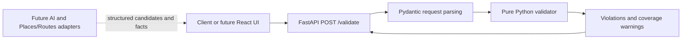

# Architecture

## Status and milestone

This is a design, not an inventory of implemented services. Before this documentation
change, the repository contained only a one-line README and one initial commit.
Only the README and the four files under `docs/` are implemented in this milestone.

The first coding milestone is a request-scoped backend validator. It accepts facts,
evaluates them, and returns explanations. It needs no persistence or network calls.

## Component boundaries



| Component | Responsibility | First MVP? |
| --- | --- | --- |
| Pydantic models | Parse JSON, enforce shape and field constraints, define response types | Yes, planned |
| Pure validator | Evaluate scheduling rules; generate deterministic explanations | Yes, planned |
| FastAPI route | Parse request, call validator, return result; use standard 422 errors | Yes, planned |
| Pytest suite | Exercise models, pure rules, immutability, and API contract offline | Yes, planned |
| React/TypeScript UI | Edit trips; display violations and missing-data warnings | Later |
| SQLite/SQLAlchemy | Store trips and versions when persistence is needed | Later |
| OpenAI adapter | Generate structured candidate activities; never determine validity | Later |
| Google Places/Routes adapters | Supply opening windows and directed travel durations | Later |
| Repair service | Propose changes to flexible events, preserve fixed events, revalidate | Later |

Dependencies flow from the HTTP layer into the models and pure validator. The
validator must not import FastAPI, SQLAlchemy, provider SDKs, or HTTP clients. It
must not read the current time, process environment, database, or network.

## Planned file layout

Every path below is **planned**, except `README.md` and the four listed documents.
Create files as their implementation tasks require them; empty scaffolding is not
part of the documentation milestone.

```text
README.md                         # exists: project overview and status
docs/
  architecture.md                 # exists: this design
  mvp-spec.md                     # exists: contract and rules
  implementation-plan.md          # exists: coding tasks
  test-plan.md                    # exists: test cases
backend/                          # planned
  __init__.py
  requirements.in                 # direct runtime/test dependency bounds
  requirements.lock               # resolved versions for reproducible installs
  app/
    __init__.py
    models.py                     # Pydantic request/response models
    validator.py                  # pure validation entry point and rule helpers
    main.py                       # app object and POST /validate
    services/                     # later: external data and planning adapters
  tests/
    __init__.py
    conftest.py                   # fresh deterministic fixture factories
    test_models.py
    test_validator.py
    test_api.py
frontend/                         # later: React/TypeScript, not created now
```

Use `backend.app` imports and run commands from the repository root. Do not add
path hacks or assume `cd backend` is interchangeable. If a future packaging change
is necessary, update the commands and tests together.

## Request lifecycle

1. FastAPI parses a `ValidationRequest` using Pydantic 2. Unknown fields, invalid
   types, negative amounts, duplicate IDs/fact keys, or naive timestamps produce
   the standard HTTP 422 response. No itinerary result is returned for malformed input.
2. The pure function `validate_itinerary(request) -> ValidationResult` creates local
   sorted/indexed views; it never reorders or edits the caller's activities.
3. It converts aware datetimes to UTC for all comparisons and elapsed durations.
   Trip date boundaries are constructed in the trip's IANA timezone, then converted
   to UTC. Monetary calculations use `Decimal`.
4. Independent checks collect violations. Travel evaluation waits until intervals
   are positive and nonoverlapping; an invalid temporal schedule produces an explicit
   skipped-travel warning instead of inventing a route order.
5. The function returns stable, sorted violations and warnings. `is_valid` means
   no violations of checked constraints; missing facts can still produce warnings.
6. The endpoint serializes the result as HTTP 200, even for an invalid itinerary.

The full contract and example payloads are in [mvp-spec.md](mvp-spec.md).

## Scope choices and ownership

- **Time:** require offset-aware timestamps and a trip timezone; use concrete
  opening windows, not a weekly opening-hours parser. There is no implicit system timezone.
- **Places:** compare stable location IDs, not names or addresses. A location is an
  ID and display name; geocoding is a later adapter responsibility.
- **Travel:** use caller-supplied integer minutes for directed consecutive legs.
  No geospatial estimation, traffic prediction, or travel-mode selection yet.
- **Money:** one currency per trip, exact cents, no conversion. Budget includes
  activity estimates only; add transport as an activity cost when it should count.
- **Fixed commitments:** `fixed=true` is a future repair constraint. Validation
  applies the same rules to every event and never moves either fixed or flexible ones.
- **Data quality:** warnings expose missing facts. An itinerary may pass known
  constraints without being fully verified against travel or opening data.

Suggested responsibilities are work areas, not assignments to assumed teammates:

| Work area | Owns | Coordination point |
| --- | --- | --- |
| Models/contracts | Request and result schemas, input-error cases | Agree on field names before API/UI work |
| Validation | Pure rules and explanations | Follow spec codes and temporal semantics |
| Tests | Shared example factories and expected behaviors | Keep fixtures independent of provider data |
| API integration | Thin route and HTTP tests | Reuse the pure function and result schema |

The tasks can be implemented by one student in order. Tests accompany each task;
the dedicated test task expands cross-rule and boundary coverage.

## Later integration guardrails

AI output is untrusted candidate input and must pass the same Pydantic and rule
checks. Provider responses should be translated into the existing fact models in
adapters, with their availability exposed. Database records should be mapped into
the request contract rather than becoming validator dependencies.

Repair should copy the candidate, treat fixed events' IDs, locations, start/end
instants, and fixed flags as invariants, modify flexible events only, and revalidate
the result. Conflicting fixed events must be explained as unsatisfied constraints;
repair cannot silently move them. The actual repair algorithm is outside this MVP.
