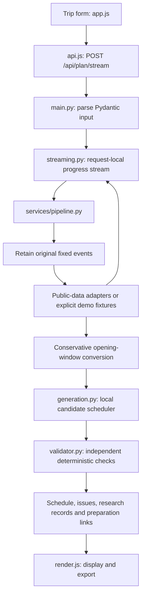

# Architecture

## Current workflow

The prototype has a Flask backend and a plain HTML/CSS/JavaScript frontend. All
application code lives under `src/`; tests and operational scripts are separate.
There is no active LLM integration or paid-service call.

`render.yaml` prepares the complete app for a free Render Web Service using
Gunicorn and `src/backend/gunicorn_config.py`. The deployment entry was verified
locally; account login/service creation and remote verification remain pending.
See [cloud deployment](cloud-demo.zh-CN.md).

`POST /api/plan` exposes the same process as a normal JSON response. `POST /validate`
can check an existing candidate without planning or network access. The candidate
and original fixed-event baseline are separate objects, so generation cannot
redefine which commitments must stay fixed.

## Module boundaries

| Area | Responsibility |
| --- | --- |
| `src/backend/app/main.py` | Flask factory, routes, request parsing and safe errors |
| `models.py` | Request/result types, limits and malformed-input checks |
| `validator.py` | Pure constraints; no HTTP, filesystem/environment reads or mutation |
| `time_utils.py` | Explicit local-time interpretation and DST ambiguity checks |
| `streaming.py` | Bounded worker/queue; newline-delimited public events to the browser |
| `services/pipeline.py` | Coordinate the entire planning operation |
| `services/providers.py` | Named no-key HTTP adapters, shared cache/rate limits |
| `services/toolbox.py` | Typed, independently callable map tools and schemas; no scheduling |
| `services/opening_hours.py` | Translate a supported subset of OSM tags to aware windows |
| `services/generation.py` | Greedy scheduling of known places around original commitments |
| `services/research.py` | Request-local public log, safe source URLs and unverified preparation items |
| `services/demo.py` | Explicit synthetic Chicago input/facts |
| `src/frontend/static/api.js` | JSON and progress-stream transport |
| `src/frontend/static/app.js` | Form state, cancellation, planning/recheck/download actions |
| `src/frontend/static/render.js` | Safe DOM rendering; no provider calls |

See [the Chinese file-by-file tour](code-tour.zh-CN.md) for the complete inventory.

The `/tools` workbench exposes these facts without running the planner, through
`GET /api/tools` and four `POST /api/tools/{city,place,attractions,routes}` calls.
Its downloadable HTML bundle is an explicit alternative transport: the user's
browser calls Open-Meteo, Overpass and OSRM directly, subject to CORS/network access.
It never calls Nominatim from a file origin. Main itinerary planning continues to
use the backend adapters. See [tool contracts](tools-workbench.zh-CN.md).

## Source evidence

A real network request records its URL and running/completed/failed state. Cache
hits are labeled cached and do not claim a new request. Observers are request-local;
only the cache and Nominatim throttle are shared across concurrent plans. The log
contains observable actions, not an LLM's private reasoning.

Demo records are explicitly examples and never claim a network visit. OSM map
records and website tags can be linked, but venue websites are not fetched here.
Preparation actions say to check ticket/reservation policies; availability and
booking requirements remain unknown. No purchase or reservation occurs.

## Public data and planning

Open-Meteo supplies city coordinates/timezone; Nominatim resolves explicit places;
Overpass returns a small nearby list and tags; OSRM provides directed driving
estimates rounded up to whole minutes. Requests are bounded, cached and attributed.

Opening strings support `24/7`, simple daily/weekday/range rules, comma-separated
spans, overnight periods and `off`/`closed`. Holidays and unsupported syntax stay
unknown. Raw venue hours use the destination timezone and destination calendar
dates even when the trip display zone differs.

The scheduler tries 60-minute visits every 15 minutes between 09:00 and 18:00.
Known facts constrain slots; an unknown transfer receives a planning buffer but is
not turned into a factual travel estimate. Unscheduled visits are reported. This
is a greedy starter, not a preference optimizer or an autonomous agent.

## Planned ownership and future work

The proposal lists Yuqing for AI integration, Che for AI/API integration, Xintong
for validation/repair, and Zhanyang for frontend. These are proposed leads, not
claims about completed work; integration and testing are shared.

A future model adapter can replace the candidate-generation step or choose which
bounded lookup tool to call next. It must retain the original commitments, use
structured results with source evidence, and pass through the same validator.
Persistence, automatic repair and arbitrary webpage reading are not implemented.
