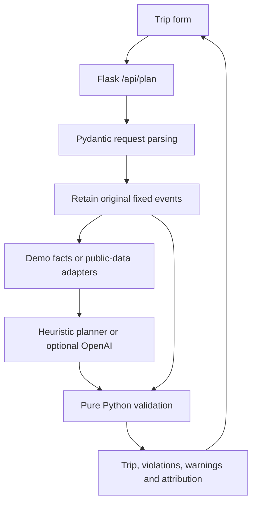

# Architecture

## Implemented workflow

The Flask application serves a small JavaScript frontend and JSON endpoints. The
rule-based planner and synthetic data make the entire application usable offline.
Live map services and optional OpenAI generation are separate, explicit selections.

`POST /validate` also exposes the pure validator independently of generation and
network services. It receives the original fixed events separately from the
candidate, so generation cannot redefine what counts as preserved.

## Files and boundaries

| Path | Responsibility |
| --- | --- |
| `backend/app/models.py` | Shape/type checks and request limits |
| `backend/app/validator.py` | Pure deterministic rules, with no I/O or mutation |
| `backend/app/time_utils.py` | Explicit local-to-aware conversion with DST checks |
| `backend/app/main.py` | Flask factory, routes, safe error responses, static assets |
| `backend/app/services/pipeline.py` | Retain baseline, collect facts, generate, validate |
| `backend/app/services/generation.py` | Greedy scheduling and optional OpenAI adapter |
| `backend/app/services/providers.py` | Cached, bounded, named public-service requests |
| `backend/app/services/opening_hours.py` | Conservative subset of OSM weekly hours |
| `backend/app/services/demo.py` | Explicit synthetic Chicago fixture and example input |
| `frontend/` | Accessible form, fixed-event input, schedule and issue display |
| `backend/tests/` | Offline model, rule, provider, pipeline and HTTP-contract tests |
| `scripts/` | Explicit live-provider and browser smoke checks |

The frontend does not receive secrets or call provider APIs directly. The validator
does not import Flask, requests, environment configuration or provider adapters.
Dependencies and prices are not inferred from an LLM's confidence.

## Planning and validation

The heuristic planner tries 60-minute visits at 15-minute increments between 09:00
and 18:00 in the trip timezone. It uses known opening windows and directed route
estimates to find slots around the original commitments. Unknown routes receive a
30-minute planning buffer but remain missing facts in the independent validator.
Activities that cannot fit are listed explicitly. This is a small greedy scheduler,
not a global optimizer, and it does not implement rich preference ranking.

The optional OpenAI adapter requests JSON, parses it through the same models,
rejects unknown or changed places, and discards ungrounded price suggestions.
It does not silently correct moved/deleted fixed events: the separate baseline
allows the validator to identify those violations. Malformed AI output yields a
clear service error. No live AI request is claimed without a configured key and
an executed test.

## External facts and uncertainty

Open-Meteo resolves the city; Nominatim resolves explicitly requested places and
fixed-event addresses; Overpass supplies a small attraction list and raw opening
tags; OSRM supplies directed driving durations, rounded up to whole minutes.
Opening tags use the destination timezone, independently of the trip display zone.
Coordinates may also be provided for fixed events through the JSON API.

Opening strings support `24/7`, daily time ranges, weekday/range selectors, comma
separated time ranges, overnight periods, and `off`/`closed`. Holiday, seasonal,
sunrise/sunset, and other unsupported expressions remain unknown. An explicit empty
set of windows means closed; no record means unavailable information.

Essential place lookup failures produce 503. Missing route data can produce a
candidate with explicit incomplete-validation warnings. There is no silent switch
from live to synthetic data. Public-service capacity and coverage are limited.

## Team responsibilities from the final proposal

These are planned leads, not claims about completed individual work:

| Member | Proposed lead responsibility |
| --- | --- |
| Yuqing | AI integration |
| Che | AI and external API integration |
| Xintong | Validation and repair logic |
| Zhanyang | Web frontend |

Backend integration, testing and interface review are shared. The current code
provides a common baseline for those areas; it does not assign ownership based on
who generated or reviewed this scaffold.

## Deliberately deferred

There is no database, authentication, booking/payment functionality, automatic
repair, live traffic, transit/walking route engine, or global optimization. Trips
remain in the browser's memory and can be downloaded as JSON. Future persistence
and repair should reuse the contracts and independently revalidate their output.
